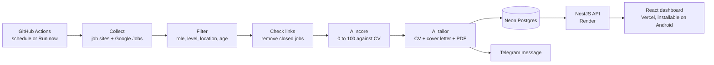

# Job Hunter

A personal job search system that runs itself. Twice a day it finds new jobs, scores them against my CV with AI, writes a tailored CV and cover letter for the best matches, and sends me a Telegram message. I review each one in a dashboard on my phone and apply myself.

Built for one person, and used for my own job search in the UAE.

**Stack:** TypeScript · NestJS 11 · Prisma 6 · PostgreSQL · React 19 + Vite · Gemini / Claude APIs · PDFKit · GitHub Actions · Render · Vercel

## How it works



1. **Collect:** pulls jobs from Remotive, Remote OK, Arbeitnow and Google Jobs. Adzuna and Jooble are optional.
2. **Filter:** cheap rules run first, so AI is only used on jobs that could fit. Jobs inside the UAE can be on-site, hybrid or remote. Jobs elsewhere must be truly remote.
3. **Check links:** closed and old jobs are removed. If a site blocks the check, the job gets a visible warning instead of being dropped.
4. **Score:** AI gives each job a score from 0 to 100, with matching skills, missing skills and red flags.
5. **Tailor:** jobs scoring 70 or more get a tailored CV as an ATS-friendly PDF, plus a cover letter.
6. **Apply and track:** I apply by hand, then track each application from applied through to offer or rejection.

**It never submits applications by itself.** Application forms differ for every company, many have CAPTCHAs, and job sites ban bots. A person checking each one also keeps quality high.

## Engineering decisions

### The AI can't invent facts

A prompt alone can't guarantee honesty on a CV, so the code enforces it after every AI reply ([`tailor.merge.ts`](apps/api/src/cv/tailor.merge.ts), with tests):

- **Titles:** the AI picks from a list of approved titles by number. It can't write a new one.
- **Skills:** they can only be reordered. Anything not already in the CV is dropped, and nothing real is removed.
- **Bullets:** if a reworded bullet contains a number that wasn't in the original, the original is used instead. This blocks made-up metrics.
- **Summary:** it's replaced with the original if it contains a number found nowhere in the CV.

### Free services that fail safely

The system runs on free plans, so limits and outages are normal and are handled in code:

- **Backup models:** if a Gemini model is overloaded, removed or out of quota, the call moves to the next model. When all are used up, the remaining jobs simply wait for the next run.
- **Validated AI output:** every reply must match a JSON schema and is checked with Zod. A bad reply only affects that one job.
- **Sources fail separately:** if one job site is down, the run continues and reports it.
- **Nothing is left silent:** every run sends a Telegram message, and a crashed run sends a link to its log.

### Dead job detection that doesn't guess

[`liveness.service.ts`](apps/api/src/jobs/liveness.service.ts) only calls a job closed on clear proof: a 404 or 410 response, or clear wording visible on the page. Bot checks, errors and pages that need JavaScript count as "unknown". This avoids hiding a job that's still open.

### Secrets stay on the server

- The real CV and all keys are stored as encrypted secrets, and the CV file is git-ignored.
- The dashboard's "Run now" button calls the API, which holds a GitHub key limited to this repo's Actions. The key never reaches the browser.
- API requests need a token compared in constant time, and CORS only allows the dashboard's address.

### Respecting the job sites

- **LinkedIn isn't scraped.** Its jobs arrive through Google Jobs.
- **Remotive** gets one request per scheduled run, within its daily limit, and manual runs skip it.
- **Attribution:** the dashboard links every job back to its source, as Remotive and Remote OK ask.

## Project layout

```
apps/api            NestJS API and the pipeline
  src/sources       one class per job site
  src/jobs          filter rules, collector, link checks, REST endpoints
  src/ai            model switching, scoring, tailoring
  src/cv            CV schema, safe merge, PDF renderer
  src/pipeline      run orchestration, Telegram message, Run now
  prisma            database schema
apps/web            React dashboard, installable as a web app
cv                  search settings and an example CV
.github/workflows   scheduled runs and CI
```

## Run it yourself

You need Node 20 or newer, a free [Neon](https://neon.tech) database and a free [Gemini API key](https://aistudio.google.com).

```bash
npm install
cp cv/base-cv.example.json cv/base-cv.json   # then fill in your real CV
cp apps/api/.env.example apps/api/.env       # then fill in DATABASE_URL, GEMINI_API_KEY, DASHBOARD_TOKEN
npm run ai:check     # tests the AI key and database
npm run db:push      # creates the tables
npm run pipeline     # one full run
npm run dev:api      # API on http://localhost:3000
npm run dev:web      # dashboard on http://localhost:5173
```

Use `npm test` for the unit tests. To run only some steps: `npm run pipeline -w apps/api -- --only=collect,score`. Edit `cv/search-config.json` to change search words, titles, locations and limits.

**Privacy:** on Gemini's free tier, Google may use your prompts, which include your CV, to improve its products. Set `AI_PROVIDER=claude` to use the paid Claude API instead.

## Deploy it (free plans)

**1. GitHub Actions.** Push to GitHub, then add these under **Settings → Secrets and variables → Actions**:

| Name | Type | Needed? |
|---|---|---|
| `DATABASE_URL`, `GEMINI_API_KEY` | Secret | Yes |
| `BASE_CV_JSON` (output of `npm run cv:secret`) | Secret | Yes |
| `SERPAPI_KEY` | Secret | For Google Jobs |
| `TELEGRAM_BOT_TOKEN`, `TELEGRAM_CHAT_ID` | Secret | For messages |
| `ANTHROPIC_API_KEY` | Secret | Only for Claude |
| `DASHBOARD_URL`, `GEMINI_TAILOR_MODEL`, `GOOGLE_MAX_SEARCHES_PER_RUN`, `AI_PROVIDER` | Variable | Optional |

Then try **Actions → Daily job hunt → Run workflow**. On a public repo, run logs and summaries are public and show job titles and companies. GitHub also turns off scheduled runs after 60 days with no repo activity.

**2. API on Render.** Go to **New → Blueprint** and pick the repo. Fill in `DATABASE_URL`, `GEMINI_API_KEY`, `BASE_CV_JSON` and `WEB_ORIGIN`. Render generates `DASHBOARD_TOKEN`, or you can set your own of at least 16 characters. Free services sleep when idle, so the first request can be slow.

**3. Dashboard on Vercel.** Add a new project, set **Root Directory** to `apps/web`, add `VITE_API_URL` with your Render URL, and deploy. Then set `WEB_ORIGIN` on Render to your Vercel address. To install it on Android, open it in Chrome, tap ⋮, then **Install app** or **Add to Home screen**.

**4. Telegram (optional).** Create a bot with [@BotFather](https://t.me/BotFather), add `TELEGRAM_BOT_TOKEN` to `apps/api/.env`, send the bot "hi", and run `npm run telegram:setup` to get your chat ID.

**5. Run now button (optional).** Create a [fine-grained GitHub token](https://github.com/settings/personal-access-tokens/new) for this repo only, with **Actions: Read and write**. On Render, add it as `GITHUB_DISPATCH_TOKEN`, and add `GITHUB_REPO` as `your-name/job-hunter`.

## Adding a job site

Write a class that implements `JobSource` in `apps/api/src/sources/`, then add it to `allSources()` in `sources/index.ts`. Check the site's terms and rate limits first.

---

Built by [Syed Aadil Ahmed](https://github.com/SyedAadil0806).
